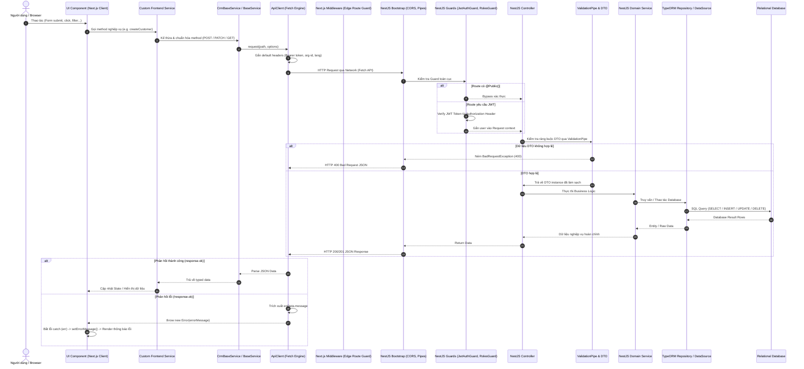

# TÀI LIỆU TOÀN DIỆN: BÓC TÁCH VÀ GIẢI THÍCH TOÀN BỘ LUỒNG GỌI API (END-TO-END FLOWS) TRONG HỆ THỐNG CRM PRO 2

> **Dự án**: CRM Pro 2 (Salon & Spa Customer Relationship Management)  
> **Kiến trúc**: Next.js App Router (Frontend) + NestJS Monorepo (Backend API) + TypeORM & PostgreSQL/MySQL (Database)  
> **Mục tiêu**: Bóc tách chi tiết 100% tất cả các luồng tương tác API từ Client đến Server và ngược lại theo cấu trúc 5 tiêu chí chuẩn hóa.

---

## MỤC LỤC TỔNG THỂ

1. [KIẾN TRÚC NỀN TẢNG & VÒNG ĐỜI REQUEST/RESPONSE CHUNG](#phần-i-kiến-trúc-nền-tảng--vòng-đời-tổng-quát)
   - [Sơ đồ tuần tự tổng quát End-to-End](#sơ-đồ-tuần-tự-tổng-quát-end-to-end)
   - [Các lớp kiến trúc chịu trách nhiệm trong hệ thống](#các-lớp-kiến-trúc-chịu-trách-nhiệm-trong-hệ-thống)
2. [MODULE 1: XÁC THỰC, PHÂN QUYỀN & BẢO MẬT (AUTH & RBAC)](#phần-ii-module-1-xác-thực-phân-quyền--bảo-mật-auth--rbac)
   - [Luồng 1.1: Đăng ký tài khoản (Register Flow)](#luồng-11-đăng-ký-tài-khoản-user-registration)
   - [Luồng 1.2: Đăng nhập & Tạo phiên JWT (Login Flow)](#luồng-12-đăng-nhập--tạo-phiên-jwt-login-flow)
   - [Luồng 1.3: Tự động làm mới Token ngầm (Silent Refresh Token & Queue Replay)](#luồng-13-tự-động-làm-mới-token-ngầm-silent-refresh-token)
   - [Luồng 1.4: Lấy hồ sơ tài khoản hiện tại (Get Profile Flow)](#luồng-14-lấy-hồ-sơ-tài-khoản-hiện-tại-get-profile)
   - [Luồng 1.5: Đăng xuất & Thanh lọc Cookie phiên (Logout Flow)](#luồng-15-đăng-xuất--thanh-lọc-phiên-logout-flow)
   - [Luồng 1.6: Phân quyền theo vai trò RBAC (Role-Based Access Control)](#luồng-16-phân-quyền-theo-vai-trò-rbac-rolesguard)
3. [MODULE 2: QUẢN LÝ KHÁCH HÀNG (CUSTOMER MANAGEMENT)](#phần-iii-module-2-quản-lý-khách-hàng-customer-management)
   - [Luồng 2.1: Truy vấn, Tìm kiếm & Phân trang khách hàng (Query & Pagination)](#luồng-21-truy-vấn-tìm-kiếm--phân-trang-khách-hàng)
   - [Luồng 2.2: Tạo mới hồ sơ khách hàng (Customer Creation)](#luồng-22-tạo-mới-hồ-sơ-khách-hàng)
   - [Luồng 2.3: Cập nhật thông tin khách hàng (Customer Update)](#luồng-23-cập-nhật-thông-tin-khách-hàng)
   - [Luồng 2.4: Xem chi tiết & Lịch sử sử dụng dịch vụ của khách hàng (Customer Details)](#luồng-24-xem-chi-tiết--lịch-sử-sử-dụng-dịch-vụ)
   - [Luồng 2.5: Xóa hồ sơ khách hàng (Customer Deletion)](#luồng-25-xóa-hồ-sơ-khách-hàng)
4. [MODULE 3: QUẢN LÝ ĐẶT LỊCH HẸN & VÒNG ĐỜI TRẠNG THÁI (APPOINTMENTS)](#phần-iv-module-3-quản-lý-đặt-lịch-hẹn--vòng-đời-trạng-thái)
   - [Luồng 3.1: Nạp danh mục Dịch vụ & Nhân sự phục vụ đặt lịch (Metadata Fetching)](#luồng-31-nạp-danh-mục-metadata-dịch-vụ--nhân-sự)
   - [Luồng 3.2: Đặt lịch hẹn mới & Kiểm soát chống trùng lịch (Double Booking Check + Transaction)](#luồng-32-đặt-lịch-hẹn-mới--kiểm-soát-chống-trùng-lịch)
   - [Luồng 3.3: Truy vấn & Lọc danh sách lịch hẹn theo điều kiện (Appointments Query & Filtering)](#luồng-33-truy-vấn--lọc-danh-sách-lịch-hẹn)
   - [Luồng 3.4: Chuyển đổi trạng thái cuộc hẹn (State Machine Transition & Audit Log)](#luồng-34-chuyển-đổi-trạng-thái-cuộc-hẹn-state-machine)
   - [Luồng 3.5: Hủy & Xóa lịch hẹn (Appointment Cancellation/Deletion)](#luồng-35-hủy--xóa-lịch-hẹn)
5. [MODULE 4: BÁO CÁO DOANH THU & PHÂN TÍCH TÀI CHÍNH (REVENUE ANALYTICS)](#phần-v-module-4-báo-cáo-doanh-thu--phân-tích-tài-chính)
   - [Luồng 4.1: Thống kê doanh thu theo tháng, ngày, dịch vụ và nhân sự](#luồng-41-thống-kê-doanh-thu-theo-tháng-ngày-dịch-vụ-và-nhân-sự)
6. [MODULE 5: BẢNG ĐIỀU KHIỂN TỔNG QUAN (DASHBOARD OVERVIEW)](#phần-vi-module-5-bảng-điều-khiển-tổng-quan-dashboard-overview)
   - [Luồng 5.1: Tổng hợp KPI đa nguồn song song (Multi-Resource Aggregation)](#luồng-51-tổng-hợp-kpi-đa-nguồn-song-song)
7. [MA TRẬN TRA CỨU ENDPOINTS & MÃ LỖI TOÀN HỆ THỐNG](#phần-vii-ma-trận-tra-cứu-endpoints--mã-lỗi-toàn-hệ-thống)

---

# PHẦN I: KIẾN TRÚC NỀN TẢNG & VÒNG ĐỜI TỔNG QUÁT

### Sơ đồ tuần tự tổng quát End-to-End



### Các lớp kiến trúc chịu trách nhiệm trong hệ thống

| Tầng (Layer) | Công nghệ / Thư viện | Vị trí trong dự án | Trách nhiệm duy nhất (SRP) |
| :--- | :--- | :--- | :--- |
| **UI Components** | React 18, TailwindCSS | `apps/frontend/src/app/**` | Thu thập input, kích hoạt event, quản lý visual state (loading, error, modal) |
| **Frontend Domain Services** | TypeScript Classes | `apps/frontend/src/common/services/**` | Đóng gói nghiệp vụ client, lưu trữ token cookie, định nghĩa kiểu DTO/Response |
| **Base Service Layer** | OOP Inheritance | `libs/frontend/common/.../base.service.ts` | Cung cấp CRUD chuẩn hóa (`list`, `show`, `create`, `update`, `destroy`) |
| **HTTP Transport Engine** | Fetch API Wrapper | `libs/frontend/common/.../api-client.ts` | Gắn Header, bắt lỗi HTTP, cơ chế Silent Refresh Token, Retry |
| **Edge Route Guard** | Next.js Middleware | `apps/frontend/src/middleware.ts` | Bảo vệ các route phía Client bằng cách giải mã exp của JWT cookie |
| **Backend Gateway** | NestJS Bootstrap | `apps/api/src/main.ts` | Thiết lập Global Prefix (`/api`), CORS policy, kích hoạt Global `ValidationPipe` |
| **Security Guards** | Passport, Reflector | `apps/api/src/app/auth/guards/**` | Kiểm tra JWT token toàn cục, đọc Metadata `@Public()`, `@Roles()` |
| **Controllers** | NestJS Controllers | `apps/api/src/app/**/*.controller.ts` | Định tuyến (Routing), trích xuất Params/Body/Query, dispatch về Service |
| **Validation Layer** | class-validator, class-transformer | `apps/api/src/app/**/dto/**` | Kiểm duyệt tính toàn vẹn của payload, lọc bỏ field thừa (`whitelist`) |
| **Domain Services** | NestJS Injectable | `apps/api/src/app/**/*.service.ts` | Chứa 100% logic nghiệp vụ, thuật toán, Transaction, mã hóa mật khẩu |
| **Data Access Layer** | TypeORM | `apps/api/src/app/**/entities/**` | Định nghĩa schema quan hệ (Entity) và cung cấp API thao tác dữ liệu (`Repository`) |

---

# PHẦN II: MODULE 1: XÁC THỰC, PHÂN QUYỀN & BẢO MẬT (AUTH & RBAC)

---

## Luồng 1.1: Đăng ký tài khoản (User Registration)

### 1. Chặng & Tên File liên quan
- **UI Component**: [`apps/frontend/src/app/register/page.tsx`](file:///home/vmms/Downloads/worksapce/learn/crm-2/apps/frontend/src/app/register/page.tsx)
- **Frontend Service**: [`apps/frontend/src/common/services/auth/auth.service.ts`](file:///home/vmms/Downloads/worksapce/learn/crm-2/apps/frontend/src/common/services/auth/auth.service.ts)
- **HTTP Client**: [`libs/frontend/common/src/lib/api/api-client.ts`](file:///home/vmms/Downloads/worksapce/learn/crm-2/libs/frontend/common/src/lib/api/api-client.ts)
- **Backend Route & Controller**: [`apps/api/src/app/auth/auth.controller.ts`](file:///home/vmms/Downloads/worksapce/learn/crm-2/apps/api/src/app/auth/auth.controller.ts)
- **DTO Validation**: [`apps/api/src/app/auth/dto/register.dto.ts`](file:///home/vmms/Downloads/worksapce/learn/crm-2/apps/api/src/app/auth/dto/register.dto.ts)
- **Domain Service**: [`apps/api/src/app/auth/auth.service.ts`](file:///home/vmms/Downloads/worksapce/learn/crm-2/apps/api/src/app/auth/auth.service.ts)
- **Data Access Layer**: [`apps/api/src/app/users/users.service.ts`](file:///home/vmms/Downloads/worksapce/learn/crm-2/apps/api/src/app/users/users.service.ts) và [`apps/api/src/app/users/entities/user.entity.ts`](file:///home/vmms/Downloads/worksapce/learn/crm-2/apps/api/src/app/users/entities/user.entity.ts)

### 2. Nội dung & Trách nhiệm của File
- `register/page.tsx`: Chứa form đăng ký tài khoản với các trường `fullName`, `email`, `password`, `phone`, `role`. Chịu trách nhiệm hiển thị trạng thái đang đăng ký (`loading`) và thông báo lỗi (`errorMessage`).
- `auth.service.ts`: Khai báo phương thức `register(dto)`. Chịu trách nhiệm cấu hình cờ `{ skipAuth: true }` để gửi request không cần token.
- `api-client.ts`: Serialize payload sang JSON, gửi POST request tới `/auth/register`.
- `auth.controller.ts`: Tiếp nhận endpoint `@Post('register')`, gắn decorator `@Public()` để bypass JWT Guard.
- `register.dto.ts`: Khai báo các decorator `@IsEmail()`, `@IsNotEmpty()`, `@MinLength(6)`, `@IsEnum(Role)`. Chịu trách nhiệm bắt lỗi cú pháp đầu vào.
- `auth.service.ts` (Backend): Kiểm tra tính duy nhất của email; băm mật khẩu bằng thuật toán Bcrypt với salt rounds = 10; gọi `UsersService` để tạo bản ghi.
- `users.service.ts`: Sử dụng `userRepository.create()` và `userRepository.save()` để ghi dữ liệu vào bảng `users`.

### 3. Cơ chế hoạt động & Code Snippet trích dẫn
- **Input**: User submit form tại `register/page.tsx`.
- **Biến đổi**: Băm mật khẩu bằng `bcrypt.hash()` tại `AuthService`.
- **Output**: Bản ghi `User` mới (đã loại bỏ trường `passwordHash`).

```typescript
// Trích dẫn từ: apps/api/src/app/auth/auth.service.ts (dòng 16-36)
async register(dto: RegisterDto) {
  const existingUser = await this.usersService.findByEmail(dto.email);
  if (existingUser) {
    throw new ConflictException('Email này đã được sử dụng');
  }

  const saltRounds = 10;
  const passwordHash = await bcrypt.hash(dto.password, saltRounds);

  const newUser = await this.usersService.create({
    email: dto.email,
    passwordHash,
    fullName: dto.fullName,
    phone: dto.phone || null,
    role: dto.role || Role.STAFF,
    isActive: true,
  });

  const { passwordHash: _, ...result } = newUser;
  return result;
}
```

### 4. Xử lý ngoại lệ (Error Handling) & Phản hồi (Response)
- **Lỗi Email trùng lặp**: Backend ném `ConflictException` (HTTP 409). `ApiClient` bắt lỗi, đọc `errData.message = 'Email này đã được sử dụng'`. Tầng UI bắt lỗi trong `catch (err)` và gán `setErrorMessage(err.message)`, hiển thị khung cảnh báo màu đỏ trên giao diện.
- **Thành công**: Backend trả về HTTP 201. Frontend điều hướng người dùng sang trang đăng nhập bằng: `router.push('/login?registered=true')`. `LoginForm` sẽ đọc query `registered=true` để hiển thị alert màu xanh báo thành công.

### 5. Link tài liệu chính thống
- [NestJS Controllers Routing](https://docs.nestjs.com/controllers#routing)
- [Bcrypt Salt and Hashing](https://www.npmjs.com/package/bcrypt#user-content-a-note-on-rounds)

---

## Luồng 1.2: Đăng nhập & Tạo phiên JWT (Login Flow)

### 1. Chặng & Tên File liên quan
- **UI Component**: [`apps/frontend/src/app/login/page.tsx`](file:///home/vmms/Downloads/worksapce/learn/crm-2/apps/frontend/src/app/login/page.tsx)
- **Frontend Service**: [`apps/frontend/src/common/services/auth/auth.service.ts`](file:///home/vmms/Downloads/worksapce/learn/crm-2/apps/frontend/src/common/services/auth/auth.service.ts)
- **HTTP Client**: [`libs/frontend/common/src/lib/api/api-client.ts`](file:///home/vmms/Downloads/worksapce/learn/crm-2/libs/frontend/common/src/lib/api/api-client.ts)
- **Edge Route Guard**: [`apps/frontend/src/middleware.ts`](file:///home/vmms/Downloads/worksapce/learn/crm-2/apps/frontend/src/middleware.ts)
- **Backend Controller**: [`apps/api/src/app/auth/auth.controller.ts`](file:///home/vmms/Downloads/worksapce/learn/crm-2/apps/api/src/app/auth/auth.controller.ts)
- **Guard & Decorator**: [`apps/api/src/app/auth/guards/jwt-auth.guard.ts`](file:///home/vmms/Downloads/worksapce/learn/crm-2/apps/api/src/app/auth/guards/jwt-auth.guard.ts) và [`apps/api/src/app/auth/decorators/public.decorator.ts`](file:///home/vmms/Downloads/worksapce/learn/crm-2/apps/api/src/app/auth/decorators/public.decorator.ts)
- **DTO Validation**: [`apps/api/src/app/auth/dto/login.dto.ts`](file:///home/vmms/Downloads/worksapce/learn/crm-2/apps/api/src/app/auth/dto/login.dto.ts)
- **Domain Service**: [`apps/api/src/app/auth/auth.service.ts`](file:///home/vmms/Downloads/worksapce/learn/crm-2/apps/api/src/app/auth/auth.service.ts)
- **Database Layer**: [`apps/api/src/app/users/users.service.ts`](file:///home/vmms/Downloads/worksapce/learn/crm-2/apps/api/src/app/users/users.service.ts)

### 2. Nội dung & Trách nhiệm của File
- `login/page.tsx`: Tiếp nhận email và mật khẩu từ người dùng, quản lý form submit, xử lý redirect sau đăng nhập.
- `auth.service.ts` (FE): Gọi API, nhận cặp token `accessToken` và `refreshToken`, sử dụng `js-cookie` để lưu vào Cookie trình duyệt.
- `jwt-auth.guard.ts`: Kiểm tra metadata `@Public()`. Nếu có, cho phép request đi qua mà không cần xác thực token.
- `login.dto.ts`: Kiểm tra email đúng định dạng và mật khẩu không rỗng qua `class-validator`.
- `auth.service.ts` (BE): Đối chiếu email trong database, dùng `bcrypt.compare` kiểm tra mật khẩu, ký token bằng `jwtService.sign()`.

### 3. Cơ chế hoạt động & Code Snippet trích dẫn
- **Input**: `{ email: dto.email, password: dto.password }`.
- **Biến đổi**: So khớp mật khẩu đã băm trong database, sinh payload `{ sub: user.id, email: user.email, role: user.role }`.
- **Output**: JSON object gồm `accessToken`, `refreshToken` và `user`.

```typescript
// Trích dẫn từ: apps/api/src/app/auth/auth.service.ts (dòng 38-63)
async login(dto: LoginDto) {
  const user = await this.usersService.findByEmail(dto.email);
  if (!user || !user.isActive) {
    throw new UnauthorizedException('Email hoặc mật khẩu không chính xác');
  }

  const isPasswordValid = await bcrypt.compare(dto.password, user.passwordHash);
  if (!isPasswordValid) {
    throw new UnauthorizedException('Email hoặc mật khẩu không chính xác');
  }

  const payload = { sub: user.id, email: user.email, role: user.role };
  const accessToken = this.jwtService.sign(payload);
  const refreshToken = this.jwtService.sign(payload, { expiresIn: '30d' });

  return {
    accessToken,
    refreshToken,
    user: {
      id: user.id,
      email: user.email,
      fullName: user.fullName,
      role: user.role,
    },
  };
}
```

```typescript
// Trích dẫn từ: apps/frontend/src/common/services/auth/auth.service.ts (dòng 23-28)
if (res.accessToken) {
  Cookies.set('accessToken', res.accessToken, { path: '/' });
  if (res.refreshToken) {
    Cookies.set('refreshToken', res.refreshToken, { path: '/' });
  }
}
```

### 4. Xử lý ngoại lệ (Error Handling) & Phản hồi (Response)
- **Sai thông tin**: Backend ném `UnauthorizedException` (HTTP 401). `ApiClient` trích xuất `errData.message` và ném Error. UI nhận lỗi và cập nhật `errorMessage`, render alert đỏ.
- **Thành công**: Frontend lưu cookie và thực thi `window.location.href = callbackUrl`. Next.js `middleware.ts` giải mã token, xác thực hạn `exp`, và cho phép truy cập các route quản trị (`/`, `/customers`, `/appointments`, `/revenue`).

### 5. Link tài liệu chính thống
- [NestJS Authentication Module](https://docs.nestjs.com/security/authentication)
- [Next.js App Router Middleware](https://nextjs.org/docs/app/building-your-application/routing/middleware)

---

## Luồng 1.3: Tự động làm mới Token ngầm (Silent Refresh Token)

### 1. Chặng & Tên File liên quan
- **Trigger**: Bất kỳ request nào nhận mã HTTP 401 từ backend trong [`libs/frontend/common/src/lib/api/api-client.ts`](file:///home/vmms/Downloads/worksapce/learn/crm-2/libs/frontend/common/src/lib/api/api-client.ts)
- **Backend Controller**: [`apps/api/src/app/auth/auth.controller.ts`](file:///home/vmms/Downloads/worksapce/learn/crm-2/apps/api/src/app/auth/auth.controller.ts)
- **Domain Service**: [`apps/api/src/app/auth/auth.service.ts`](file:///home/vmms/Downloads/worksapce/learn/crm-2/apps/api/src/app/auth/auth.service.ts)

### 2. Nội dung & Trách nhiệm của File
- `api-client.ts`: Đóng vai trò là Interceptor. Chịu trách nhiệm phát hiện mã 401, tạm dừng các request đang chờ trong hàng đợi `refreshSubscribers`, gửi request lấy token mới và tự động replay các request cũ mà người dùng không hề hay biết.
- `auth.controller.ts`: Tiếp nhận endpoint `@Public()` `@Post('refresh')`.
- `auth.service.ts`: Giải mã refresh token bằng `jwtService.verify`, kiểm tra tính hợp lệ của tài khoản trong database và cấp phát một `accessToken` mới.

### 3. Cơ chế hoạt động & Code Snippet trích dẫn
- **Input**: `refreshToken` được lấy từ Cookie của trình duyệt.
- **Biến đổi**: Backend kiểm tra chữ ký token, truy vấn `findById(decoded.sub)`.
- **Output**: `{ accessToken: newAccessToken }`.

```typescript
// Trích dẫn từ: libs/frontend/common/src/lib/api/api-client.ts (dòng 163-186)
if (response.status === 401 && !skipAuth) {
  if (!this.isRefreshing) {
    this.isRefreshing = true;
    const newToken = await this.handleRefreshToken();
    this.isRefreshing = false;
    this.onTokenRefreshed(newToken);

    if (newToken) {
      return this.request<T>(path, { ...options, retryCount: retryCount + 1 });
    }
    throw new Error('Phiên đăng nhập đã hết hạn. Vui lòng đăng nhập lại.');
  }

  // Nếu đang trong quá trình refresh, đợi token mới
  return new Promise<T>((resolve, reject) => {
    this.addRefreshSubscriber((token) => {
      if (token) {
        resolve(this.request<T>(path, { ...options, retryCount: retryCount + 1 }));
      } else {
        reject(new Error('Phiên đăng nhập đã hết hạn.'));
      }
    });
  });
}
```

```typescript
// Trích dẫn từ: apps/api/src/app/auth/auth.service.ts (dòng 65-79)
async refreshToken(token: string) {
  try {
    const decoded = this.jwtService.verify(token);
    const user = await this.usersService.findById(decoded.sub);
    if (!user || !user.isActive) {
      throw new UnauthorizedException('Tài khoản không hợp lệ hoặc đã bị khóa');
    }

    const payload = { sub: user.id, email: user.email, role: user.role };
    const newAccessToken = this.jwtService.sign(payload);
    return { accessToken: newAccessToken };
  } catch {
    throw new UnauthorizedException('Phiên đăng nhập không hợp lệ');
  }
}
```

### 4. Xử lý ngoại lệ (Error Handling) & Phản hồi (Response)
- **Nếu refresh token hết hạn hoặc giả mạo**: Backend ném `UnauthorizedException`. Frontend bắt lỗi tại `handleRefreshToken()`, lập tức xóa sạch cookie (`clearAuthCookies()`) và thực hiện `window.location.href = '/login'` buộc người dùng đăng nhập lại.

### 5. Link tài liệu chính thống
- [OAuth 2.0 Refresh Token Grant](https://datatracker.ietf.org/doc/html/rfc6749#section-1.5)
- [Axios/Fetch Interceptor Pattern](https://developer.mozilla.org/en-US/docs/Web/API/Fetch_API/Using_Fetch)

---

## Luồng 1.4: Lấy hồ sơ tài khoản hiện tại (Get Profile)

### 1. Chặng & Tên File liên quan
- **Frontend Service**: [`apps/frontend/src/common/services/auth/auth.service.ts`](file:///home/vmms/Downloads/worksapce/learn/crm-2/apps/frontend/src/common/services/auth/auth.service.ts)
- **Backend Route & Controller**: [`apps/api/src/app/auth/auth.controller.ts`](file:///home/vmms/Downloads/worksapce/learn/crm-2/apps/api/src/app/auth/auth.controller.ts)
- **Security Guard**: [`apps/api/src/app/auth/guards/jwt-auth.guard.ts`](file:///home/vmms/Downloads/worksapce/learn/crm-2/apps/api/src/app/auth/guards/jwt-auth.guard.ts)
- **Strategy**: [`apps/api/src/app/auth/strategies/jwt.strategy.ts`](file:///home/vmms/Downloads/worksapce/learn/crm-2/apps/api/src/app/auth/strategies/jwt.strategy.ts)
- **Domain Service**: [`apps/api/src/app/auth/auth.service.ts`](file:///home/vmms/Downloads/worksapce/learn/crm-2/apps/api/src/app/auth/auth.service.ts)

### 2. Nội dung & Trách nhiệm của File
- `auth.service.ts` (FE): Gửi GET request tới `/auth/me` kèm theo header `Authorization: Bearer <accessToken>`.
- `jwt-auth.guard.ts` & `jwt.strategy.ts`: Trích xuất token từ header, giải mã và gắn thông tin người dùng vào `req.user`.
- `auth.controller.ts`: Endpoint `@Get('me')` nhận `req.user.id` và gọi service.
- `auth.service.ts` (BE): Tìm user theo id và loại bỏ trường `passwordHash`.

### 3. Cơ chế hoạt động & Code Snippet trích dẫn
```typescript
// Trích dẫn từ: apps/api/src/app/auth/auth.controller.ts (dòng 29-32)
@Get('me')
getMe(@Request() req: { user: { id: string } }) {
  return this.authService.getMe(req.user.id);
}
```

```typescript
// Trích dẫn từ: apps/api/src/app/auth/auth.service.ts (dòng 81-88)
async getMe(userId: string) {
  const user = await this.usersService.findById(userId);
  if (!user) {
    throw new UnauthorizedException('Không tìm thấy thông tin tài khoản');
  }
  const { passwordHash: _, ...result } = user;
  return result;
}
```

### 4. Xử lý ngoại lệ & Phản hồi
- Nếu token không hợp lệ: `JwtAuthGuard` ném mã 401 Unauthorized trước khi chạm tới Controller.
- Thành công: Trả về HTTP 200 kèm JSON thông tin `id`, `email`, `fullName`, `role`.

### 5. Link tài liệu chính thống
- [NestJS Passport Strategy](https://docs.nestjs.com/security/authentication#request-scoped-strategies)

---

## Luồng 1.5: Đăng xuất & Thanh lọc phiên (Logout Flow)

### 1. Chặng & Tên File liên quan
- **Frontend Service**: [`apps/frontend/src/common/services/auth/auth.service.ts`](file:///home/vmms/Downloads/worksapce/learn/crm-2/apps/frontend/src/common/services/auth/auth.service.ts)
- **Edge Route Guard**: [`apps/frontend/src/middleware.ts`](file:///home/vmms/Downloads/worksapce/learn/crm-2/apps/frontend/src/middleware.ts)

### 2. Nội dung & Trách nhiệm của File
- `auth.service.ts`: Khai báo phương thức `logout()`. Chịu trách nhiệm xóa toàn bộ cookie liên quan (`accessToken`, `session_token`, `refreshToken`) trên cả root domain (`path: '/'`) và chuyển hướng trình duyệt về `/login`.
- `middleware.ts`: Phát hiện không còn token hợp lệ, tự động ngăn chặn truy cập các trang nội bộ nếu người dùng cố ấn nút quay lại (Back) trên trình duyệt.

### 3. Cơ chế hoạt động & Code Snippet trích dẫn
```typescript
// Trích dẫn từ: apps/frontend/src/common/services/auth/auth.service.ts (dòng 47-57)
public logout(): void {
  Cookies.remove('accessToken', { path: '/' });
  Cookies.remove('accessToken');
  Cookies.remove('session_token', { path: '/' });
  Cookies.remove('session_token');
  Cookies.remove('refreshToken', { path: '/' });
  Cookies.remove('refreshToken');
  if (typeof window !== 'undefined') {
    window.location.href = '/login';
  }
}
```

### 4. Link tài liệu chính thống
- [MDN Document.cookie](https://developer.mozilla.org/en-US/docs/Web/API/Document/cookie)

---

## Luồng 1.6: Phân quyền theo vai trò RBAC (RolesGuard)

### 1. Chặng & Tên File liên quan
- **Security Guard**: [`apps/api/src/app/auth/guards/roles.guard.ts`](file:///home/vmms/Downloads/worksapce/learn/crm-2/apps/api/src/app/auth/guards/roles.guard.ts)
- **Role Decorator**: [`apps/api/src/app/auth/decorators/roles.decorator.ts`](file:///home/vmms/Downloads/worksapce/learn/crm-2/apps/api/src/app/auth/decorators/roles.decorator.ts)
- **Ví dụ Endpoint áp dụng**: [`apps/api/src/app/revenue/revenue.controller.ts`](file:///home/vmms/Downloads/worksapce/learn/crm-2/apps/api/src/app/revenue/revenue.controller.ts)

### 2. Nội dung & Trách nhiệm của File
- `roles.decorator.ts`: Khai báo decorator `@Roles(...roles: Role[])` sử dụng `SetMetadata`.
- `roles.guard.ts`: Đọc metadata của handler/class qua `Reflector`. So sánh mảng vai trò yêu cầu với `req.user.role`. Nếu không khớp, ném ra lỗi 403 Forbidden.

### 3. Cơ chế hoạt động & Code Snippet trích dẫn
```typescript
// Trích dẫn từ: apps/api/src/app/auth/guards/roles.guard.ts (dòng 21-36)
const requiredRoles = this.reflector.getAllAndOverride<Role[]>(ROLES_KEY, [
  context.getHandler(),
  context.getClass(),
]);

if (!requiredRoles || requiredRoles.length === 0) {
  return true;
}

const { user } = context.switchToHttp().getRequest();
if (!user || !requiredRoles.includes(user.role)) {
  throw new ForbiddenException('Bạn không có quyền thực hiện hành động này');
}

return true;
```

```typescript
// Trích dẫn từ: apps/api/src/app/revenue/revenue.controller.ts (dòng 11-15)
@Get()
@Roles(Role.ADMIN)
getRevenue(@Query() query: RevenueQueryDto) {
  return this.revenueService.getRevenueReport(query);
}
```

### 4. Xử lý ngoại lệ & Phản hồi
- Nếu tài khoản có vai trò `STAFF` gọi vào `/api/revenue`, `RolesGuard` ném `ForbiddenException` (HTTP 403). `ApiClient` ở frontend bắt lỗi và hiển thị cảnh báo: *"Bạn không có quyền thực hiện hành động này"*.

### 5. Link tài liệu chính thống
- [NestJS Role-based Access Control](https://docs.nestjs.com/security/authorization#basic-rbac-implementation)

---

# PHẦN III: MODULE 2: QUẢN LÝ KHÁCH HÀNG (CUSTOMER MANAGEMENT)

---

## Luồng 2.1: Truy vấn, Tìm kiếm & Phân trang khách hàng

### 1. Chặng & Tên File liên quan
- **UI Component**: [`apps/frontend/src/app/customers/customer-table.tsx`](file:///home/vmms/Downloads/worksapce/learn/crm-2/apps/frontend/src/app/customers/customer-table.tsx)
- **Frontend Service**: [`apps/frontend/src/common/services/crm/customers/customer.service.ts`](file:///home/vmms/Downloads/worksapce/learn/crm-2/apps/frontend/src/common/services/crm/customers/customer.service.ts)
- **Base Service**: [`libs/frontend/common/src/lib/api/base.service.ts`](file:///home/vmms/Downloads/worksapce/learn/crm-2/libs/frontend/common/src/lib/api/base.service.ts)
- **HTTP Client**: [`libs/frontend/common/src/lib/api/api-client.ts`](file:///home/vmms/Downloads/worksapce/learn/crm-2/libs/frontend/common/src/lib/api/api-client.ts)
- **Backend Controller**: [`apps/api/src/app/customers/customers.controller.ts`](file:///home/vmms/Downloads/worksapce/learn/crm-2/apps/api/src/app/customers/customers.controller.ts)
- **Domain Service**: [`apps/api/src/app/customers/customers.service.ts`](file:///home/vmms/Downloads/worksapce/learn/crm-2/apps/api/src/app/customers/customers.service.ts)
- **Database Entity**: [`apps/api/src/app/customers/entities/customer.entity.ts`](file:///home/vmms/Downloads/worksapce/learn/crm-2/apps/api/src/app/customers/entities/customer.entity.ts)

### 2. Nội dung & Trách nhiệm của File
- `customer-table.tsx`: Chứa bảng danh sách khách hàng, ô tìm kiếm từ khóa (`searchTerm`), nút phân trang, quản lý trạng thái `loading`, `error`, `customers` và `meta`.
- `customer.service.ts`: Định nghĩa class `CustomerService` kế thừa `CrmBaseService<Customer>`, cung cấp hàm `getCustomers(params)`.
- `customers.controller.ts`: Tiếp nhận HTTP `GET /customers`, sử dụng `ParseIntPipe` để ép kiểu và gán mặc định `page = 1`, `limit = 10`.
- `customers.service.ts`: Tính toán offset `skip = (page - 1) * limit`, xây dựng điều kiện `Like` cho `fullName` và `phone`, gọi `findAndCount()` của TypeORM.

### 3. Cơ chế hoạt động & Code Snippet trích dẫn
- **Input**: Query params `{ page: 1, limit: 10, search: '098' }`.
- **Biến đổi**: Tính toán số trang `totalPages = Math.ceil(total / limit)`.
- **Output**: Cấu trúc phân trang chuẩn `{ meta: { total, page, limit, totalPages }, data: Customer[] }`.

```typescript
// Trích dẫn từ: apps/api/src/app/customers/customers.service.ts (dòng 42-69)
async findAll(page = 1, limit = 10, search?: string) {
  const skip = (page - 1) * limit;

  let where = {};
  if (search) {
    where = [
      { fullName: Like(`%${search}%`) },
      { phone: Like(`%${search}%`) },
    ];
  }

  const [data, total] = await this.customerRepository.findAndCount({
    where,
    skip,
    take: limit,
    order: { createdAt: 'DESC' },
  });

  return {
    meta: {
      total,
      page,
      limit,
      totalPages: Math.ceil(total / limit),
    },
    data,
  };
}
```

```typescript
// Trích dẫn từ: apps/frontend/src/app/customers/customer-table.tsx (dòng 31-45)
const fetchCustomersData = useCallback(async (page: number, search: string) => {
  setLoading(true);
  setError('');
  try {
    const res = await customerService.getCustomers({ page, limit: 10, search });
    setCustomers(res.data || []);
    setMeta(res.meta || { page: 1, limit: 10, total: 0, totalPages: 1 });
  } catch (err: any) {
    setError(err.message || 'Lỗi khi tải danh sách khách hàng');
  } finally {
    setLoading(false);
  }
}, []);
```

### 4. Xử lý ngoại lệ & Phản hồi
- Nếu DB lỗi hoặc mất mạng: `catch (err)` gán `setError(err.message)`. Bảng danh sách render hàng thông báo lỗi màu đỏ kèm nút thử lại.
- Dữ liệu trả về thành công: State `customers` được duyệt và render qua thẻ `<tbody>`, các nút Next/Previous cập nhật theo `meta.totalPages`.

### 5. Link tài liệu chính thống
- [TypeORM findAndCount](https://typeorm.io/repository-api#repository-api)
- [NestJS ParseIntPipe](https://docs.nestjs.com/pipes#built-in-pipes)

---

## Luồng 2.2: Tạo mới hồ sơ khách hàng

### 1. Chặng & Tên File liên quan
- **UI Component**: [`apps/frontend/src/app/customers/customer-form-dialog.tsx`](file:///home/vmms/Downloads/worksapce/learn/crm-2/apps/frontend/src/app/customers/customer-form-dialog.tsx)
- **Frontend Service**: [`apps/frontend/src/common/services/crm/customers/customer.service.ts`](file:///home/vmms/Downloads/worksapce/learn/crm-2/apps/frontend/src/common/services/crm/customers/customer.service.ts)
- **Backend Controller**: [`apps/api/src/app/customers/customers.controller.ts`](file:///home/vmms/Downloads/worksapce/learn/crm-2/apps/api/src/app/customers/customers.controller.ts)
- **DTO Validation**: [`apps/api/src/app/customers/dto/create-customer.dto.ts`](file:///home/vmms/Downloads/worksapce/learn/crm-2/apps/api/src/app/customers/dto/create-customer.dto.ts)
- **Domain Service**: [`apps/api/src/app/customers/customers.service.ts`](file:///home/vmms/Downloads/worksapce/learn/crm-2/apps/api/src/app/customers/customers.service.ts)

### 2. Nội dung & Trách nhiệm của File
- `customer-form-dialog.tsx`: Modal tạo/sửa thông tin khách hàng với form validation phía client (họ tên, số điện thoại, email, giới tính, ngày sinh, ghi chú).
- `create-customer.dto.ts`: Kiểm tra ràng buộc `@IsNotEmpty()`, `@IsPhoneNumber('VN')`, `@IsEmail()`, `@IsOptional()`.
- `customers.service.ts`: Kiểm tra trùng số điện thoại (`phone`). Nếu trùng, quăng `ConflictException`. Sau đó lưu bản ghi.

### 3. Cơ chế hoạt động & Code Snippet trích dẫn
```typescript
// Trích dẫn từ: apps/api/src/app/customers/customers.service.ts (dòng 19-40)
async create(dto: CreateCustomerDto) {
  const existing = await this.customerRepository.findOne({
    where: { phone: dto.phone },
  });

  if (existing) {
    throw new ConflictException(
      'Số điện thoại khách hàng đã tồn tại trên hệ thống',
    );
  }

  const customer = this.customerRepository.create({
    fullName: dto.fullName,
    phone: dto.phone,
    email: dto.email,
    gender: dto.gender,
    dob: dto.dob ? new Date(dto.dob) : null,
    notes: dto.notes,
  });

  return this.customerRepository.save(customer);
}
```

### 4. Xử lý ngoại lệ & Phản hồi
- Trùng số điện thoại: Backend trả về HTTP 409 Conflict với message rõ ràng. Dialog hiển thị banner lỗi đỏ ngay trên nút submit mà không đóng form, giúp người dùng chỉnh sửa ngay.
- Thành công: Đóng dialog, kích hoạt callback `onSuccess()` để `CustomerTable` tải lại dữ liệu mới nhất.

### 5. Link tài liệu chính thống
- [NestJS Built-in HTTP Exceptions](https://docs.nestjs.com/exception-filters#built-in-http-exceptions)

---

## Luồng 2.3: Cập nhật thông tin khách hàng

### 1. Chặng & Tên File liên quan
- **UI Component**: [`apps/frontend/src/app/customers/customer-form-dialog.tsx`](file:///home/vmms/Downloads/worksapce/learn/crm-2/apps/frontend/src/app/customers/customer-form-dialog.tsx)
- **Frontend Service**: [`apps/frontend/src/common/services/crm/customers/customer.service.ts`](file:///home/vmms/Downloads/worksapce/learn/crm-2/apps/frontend/src/common/services/crm/customers/customer.service.ts)
- **CRM Base Service**: [`apps/frontend/src/common/services/crm/crm-base.service.ts`](file:///home/vmms/Downloads/worksapce/learn/crm-2/apps/frontend/src/common/services/crm/crm-base.service.ts)
- **Backend Controller**: [`apps/api/src/app/customers/customers.controller.ts`](file:///home/vmms/Downloads/worksapce/learn/crm-2/apps/api/src/app/customers/customers.controller.ts)
- **DTO Validation**: [`apps/api/src/app/customers/dto/update-customer.dto.ts`](file:///home/vmms/Downloads/worksapce/learn/crm-2/apps/api/src/app/customers/dto/update-customer.dto.ts)
- **Domain Service**: [`apps/api/src/app/customers/customers.service.ts`](file:///home/vmms/Downloads/worksapce/learn/crm-2/apps/api/src/app/customers/customers.service.ts)

### 2. Nội dung & Trách nhiệm của File
- `crm-base.service.ts`: Override method `update()` mặc định của `BaseService` để sử dụng HTTP `PATCH` thay cho `PUT`, đồng bộ hoàn hảo với `@Patch(':id')` của NestJS.
- `customers.service.ts`: Tìm khách hàng theo ID. Nếu đổi số điện thoại, kiểm tra số mới không bị trùng với người khác bằng `Not(id)`. Dùng `customerRepository.merge` và `save()`.

### 3. Cơ chế hoạt động & Code Snippet trích dẫn
```typescript
// Trích dẫn từ: apps/frontend/src/common/services/crm/crm-base.service.ts (dòng 4-15)
export abstract class CrmBaseService<T> extends BaseService<T> {
  public override update(
    id: string | number,
    data: Partial<T> | any,
    options?: RequestOptions,
  ): Promise<ApiItemResponse<T>> {
    return this.client.patch<ApiItemResponse<T>>(
      `${this.basePath}/${id}`,
      data,
      options,
    );
  }
  // ...
}
```

```typescript
// Trích dẫn từ: apps/api/src/app/customers/customers.service.ts (dòng 89-109)
async update(id: string, dto: UpdateCustomerDto) {
  const customer = await this.findOne(id);

  if (dto.phone && dto.phone !== customer.phone) {
    const duplicate = await this.customerRepository.findOne({
      where: { phone: dto.phone, id: Not(id) },
    });
    if (duplicate) {
      throw new ConflictException(
        'Số điện thoại mới đã được sử dụng bởi khách hàng khác',
      );
    }
  }

  const updated = this.customerRepository.merge(customer, {
    ...dto,
    dob: dto.dob ? new Date(dto.dob) : customer.dob,
  });

  return this.customerRepository.save(updated);
}
```

### 4. Link tài liệu chính thống
- [TypeORM Repository merge API](https://typeorm.io/repository-api#repository-api)
- [HTTP PATCH Method Semantics](https://developer.mozilla.org/en-US/docs/Web/HTTP/Methods/PATCH)

---

## Luồng 2.4: Xem chi tiết & Lịch sử sử dụng dịch vụ

### 1. Chặng & Tên File liên quan
- **UI Component**: [`apps/frontend/src/app/customers/customer-details-dialog.tsx`](file:///home/vmms/Downloads/worksapce/learn/crm-2/apps/frontend/src/app/customers/customer-details-dialog.tsx)
- **Frontend Service**: [`apps/frontend/src/common/services/crm/customers/customer.service.ts`](file:///home/vmms/Downloads/worksapce/learn/crm-2/apps/frontend/src/common/services/crm/customers/customer.service.ts)
- **Backend Controller**: [`apps/api/src/app/customers/customers.controller.ts`](file:///home/vmms/Downloads/worksapce/learn/crm-2/apps/api/src/app/customers/customers.controller.ts)
- **Domain Service**: [`apps/api/src/app/customers/customers.service.ts`](file:///home/vmms/Downloads/worksapce/learn/crm-2/apps/api/src/app/customers/customers.service.ts)

### 2. Nội dung & Trách nhiệm của File
- `customer-details-dialog.tsx`: Render hồ sơ khách hàng đầy đủ, tổng hợp lịch sử các cuộc hẹn, tính toán tổng số tiền đã chi tiêu và hiển thị thông tin kỹ thuật viên phụ trách.
- `customers.service.ts`: Nạp dữ liệu quan hệ lồng nhau (Eager Relations) thông qua TypeORM relations: `appointments.service` và `appointments.staff`.

### 3. Cơ chế hoạt động & Code Snippet trích dẫn
```typescript
// Trích dẫn từ: apps/api/src/app/customers/customers.service.ts (dòng 71-87)
async findOne(id: string) {
  const customer = await this.customerRepository.findOne({
    where: { id },
    relations: {
      appointments: {
        service: true,
        staff: true,
      },
    },
  });

  if (!customer) {
    throw new NotFoundException(`Không tìm thấy khách hàng với ID #${id}`);
  }

  return customer;
}
```

### 4. Xử lý ngoại lệ & Phản hồi
- Nếu ID không tồn tại: Quăng `NotFoundException` (HTTP 404). Dialog hiển thị thông báo lỗi.
- Thành công: Trả về object khách hàng kèm toàn bộ mảng `appointments` được populate đầy đủ tên dịch vụ và tên nhân viên.

### 5. Link tài liệu chính thống
- [TypeORM Relations Queries](https://typeorm.io/find-options#relations)

---

## Luồng 2.5: Xóa hồ sơ khách hàng

### 1. Chặng & Tên File liên quan
- **UI Component**: [`apps/frontend/src/app/customers/customer-delete-dialog.tsx`](file:///home/vmms/Downloads/worksapce/learn/crm-2/apps/frontend/src/app/customers/customer-delete-dialog.tsx)
- **Frontend Service**: [`apps/frontend/src/common/services/crm/customers/customer.service.ts`](file:///home/vmms/Downloads/worksapce/learn/crm-2/apps/frontend/src/common/services/crm/customers/customer.service.ts)
- **CRM Base Service**: [`apps/frontend/src/common/services/crm/crm-base.service.ts`](file:///home/vmms/Downloads/worksapce/learn/crm-2/apps/frontend/src/common/services/crm/crm-base.service.ts)
- **Backend Controller**: [`apps/api/src/app/customers/customers.controller.ts`](file:///home/vmms/Downloads/worksapce/learn/crm-2/apps/api/src/app/customers/customers.controller.ts)
- **Domain Service**: [`apps/api/src/app/customers/customers.service.ts`](file:///home/vmms/Downloads/worksapce/learn/crm-2/apps/api/src/app/customers/customers.service.ts)

### 2. Nội dung & Trách nhiệm của File
- `customer-delete-dialog.tsx`: Hộp thoại xác nhận hành động nguy hiểm nhằm tránh thao tác bấm nhầm của nhân sự.
- `crm-base.service.ts`: Triển khai hàm `destroy(id)`, tự động trích xuất `currentOrganizationId` từ localStorage để gắn vào query params khi gửi DELETE request.
- `customers.service.ts`: Gọi `findOne(id)` để kiểm tra khách hàng tồn tại, sau đó thực thi `customerRepository.remove(customer)`.

### 3. Cơ chế hoạt động & Code Snippet trích dẫn
```typescript
// Trích dẫn từ: apps/api/src/app/customers/customers.service.ts (dòng 111-114)
async remove(id: string) {
  const customer = await this.findOne(id);
  return this.customerRepository.remove(customer);
}
```

### 4. Link tài liệu chính thống
- [TypeORM Repository remove](https://typeorm.io/repository-api)

---

# PHẦN IV: MODULE 3: QUẢN LÝ ĐẶT LỊCH HẸN & VÒNG ĐỜI TRẠNG THÁI

---

## Luồng 3.1: Nạp danh mục Metadata Dịch vụ & Nhân sự

### 1. Chặng & Tên File liên quan
- **UI Component**: [`apps/frontend/src/app/appointments/appointment-create-dialog.tsx`](file:///home/vmms/Downloads/worksapce/learn/crm-2/apps/frontend/src/app/appointments/appointment-create-dialog.tsx)
- **Frontend Service**: [`apps/frontend/src/common/services/crm/appointments/appointment.service.ts`](file:///home/vmms/Downloads/worksapce/learn/crm-2/apps/frontend/src/common/services/crm/appointments/appointment.service.ts)
- **Backend Controller**: [`apps/api/src/app/appointments/appointments.controller.ts`](file:///home/vmms/Downloads/worksapce/learn/crm-2/apps/api/src/app/appointments/appointments.controller.ts)
- **Domain Service**: [`apps/api/src/app/appointments/appointments.service.ts`](file:///home/vmms/Downloads/worksapce/learn/crm-2/apps/api/src/app/appointments/appointments.service.ts)

### 2. Nội dung & Trách nhiệm của File
- `appointment-create-dialog.tsx`: Khi mở modal, tự động gọi nạp danh sách dịch vụ đang mở và danh sách nhân viên đang hoạt động để đổ vào combobox.
- `appointments.controller.ts`: Khai báo 2 route metadata chuyên dụng: `@Get('meta/services')` và `@Get('meta/staff')`.
- `appointments.service.ts`: Truy vấn `Service` và `User` có cờ `isActive: true`.

### 3. Cơ chế hoạt động & Code Snippet trích dẫn
```typescript
// Trích dẫn từ: apps/api/src/app/appointments/appointments.service.ts (dòng 239-254)
async getServices() {
  return this.serviceRepository.find({
    where: { isActive: true },
    order: { name: 'ASC' },
  });
}

async getStaff() {
  return this.userRepository.find({
    where: { isActive: true },
    select: ['id', 'email', 'fullName', 'role'],
    order: { fullName: 'ASC' },
  });
}
```

### 4. Link tài liệu chính thống
- [TypeORM select specific columns](https://typeorm.io/find-options#select)

---

## Luồng 3.2: Đặt lịch hẹn mới & Kiểm soát chống trùng lịch

### 1. Chặng & Tên File liên quan
- **UI Component**: [`apps/frontend/src/app/appointments/appointment-create-dialog.tsx`](file:///home/vmms/Downloads/worksapce/learn/crm-2/apps/frontend/src/app/appointments/appointment-create-dialog.tsx)
- **Frontend Service**: [`apps/frontend/src/common/services/crm/appointments/appointment.service.ts`](file:///home/vmms/Downloads/worksapce/learn/crm-2/apps/frontend/src/common/services/crm/appointments/appointment.service.ts)
- **Backend Controller**: [`apps/api/src/app/appointments/appointments.controller.ts`](file:///home/vmms/Downloads/worksapce/learn/crm-2/apps/api/src/app/appointments/appointments.controller.ts)
- **DTO Validation**: [`apps/api/src/app/appointments/dto/create-appointment.dto.ts`](file:///home/vmms/Downloads/worksapce/learn/crm-2/apps/api/src/app/appointments/dto/create-appointment.dto.ts)
- **Domain Service**: [`apps/api/src/app/appointments/appointments.service.ts`](file:///home/vmms/Downloads/worksapce/learn/crm-2/apps/api/src/app/appointments/appointments.service.ts)
- **Database Transaction**: Sử dụng TypeORM `DataSource.transaction()`
- **Entities**: [`Appointment`](file:///home/vmms/Downloads/worksapce/learn/crm-2/apps/api/src/app/appointments/entities/appointment.entity.ts) và [`AppointmentLog`](file:///home/vmms/Downloads/worksapce/learn/crm-2/apps/api/src/app/appointments/entities/appointment-log.entity.ts)

### 2. Nội dung & Trách nhiệm của File
- `appointment-create-dialog.tsx`: Thu thập `customerId`, `staffId`, `serviceId`, `startTime`, `notes`.
- `create-appointment.dto.ts`: Kiểm tra kiểu dữ liệu ID, chuỗi ngày giờ ISO 8601 (`@IsDateString()`).
- `appointments.service.ts`:
  1. Kiểm tra sự tồn tại và tính hoạt động của Customer, Staff, Service.
  2. Tự động tính toán thời điểm kết thúc: `endTime = startTime + durationMinutes * 60000`.
  3. **Thuật toán kiểm tra xung đột thời gian (Double Booking)**: Tìm các cuộc hẹn của nhân viên mà `appt.startTime < :endTime AND appt.endTime > :startTime` (loại trừ trạng thái `CANCELED` và `NO_SHOW`).
  4. Mở **Database Transaction**: Lưu bản ghi `Appointment` (mặc định trạng thái `PENDING`), đồng thời lưu nhật ký khởi tạo vào bảng `appointment_logs`.

### 3. Cơ chế hoạt động & Code Snippet trích dẫn
```typescript
// Trích dẫn từ: apps/api/src/app/appointments/appointments.service.ts (dòng 59-118)
// 2. Tính toán endTime tự động dựa trên durationMinutes của dịch vụ
const startTime = new Date(dto.startTime);
const endTime = new Date(
  startTime.getTime() + service.durationMinutes * 60 * 1000,
);

// 3. Logic chống trùng lịch (Double Booking Check)
const conflictingAppointment = await this.appointmentRepository
  .createQueryBuilder('appt')
  .where('appt.staffId = :staffId', { staffId })
  .andWhere('appt.status NOT IN (:...excludedStatuses)', {
    excludedStatuses: [
      AppointmentStatus.CANCELED,
      AppointmentStatus.NO_SHOW,
    ],
  })
  .andWhere('appt.startTime < :endTime AND appt.endTime > :startTime', {
    startTime,
    endTime,
  })
  .getOne();

if (conflictingAppointment) {
  throw new ConflictException(
    'Nhân viên đã có lịch hẹn khác trong khung giờ này. Vui lòng chọn giờ khác.',
  );
}

// 4. Lưu lịch hẹn và tạo log trong Transaction
return this.dataSource.transaction(async (manager) => {
  const appt = manager.create(Appointment, {
    customerId,
    staffId,
    serviceId,
    startTime,
    endTime,
    price: service.price,
    notes: dto.notes,
    status: AppointmentStatus.PENDING,
  });
  const savedAppt = await manager.save(appt);

  const log = manager.create(AppointmentLog, {
    appointmentId: savedAppt.id,
    oldStatus: null,
    newStatus: AppointmentStatus.PENDING,
    note: 'Tạo mới lịch hẹn',
  });
  await manager.save(log);

  return savedAppt;
});
```

### 4. Xử lý ngoại lệ & Phản hồi
- Trùng lịch hẹn: Backend quăng `ConflictException` (HTTP 409). Frontend bắt thông báo và render cảnh báo màu vàng/đỏ ngay trong modal để người dùng chọn lại khung giờ.
- Thành công: Hoàn tất Transaction, gửi trả đối tượng lịch hẹn mới, modal tự động đóng và reload danh sách.

### 5. Link tài liệu chính thống
- [TypeORM Transactions](https://typeorm.io/transactions)
- [Allen's Interval Algebra for Time Overlap](https://en.wikipedia.org/wiki/Allen%27s_interval_algebra)

---

## Luồng 3.3: Truy vấn & Lọc danh sách lịch hẹn

### 1. Chặng & Tên File liên quan
- **UI Component**: [`apps/frontend/src/app/appointments/appointment-table.tsx`](file:///home/vmms/Downloads/worksapce/learn/crm-2/apps/frontend/src/app/appointments/appointment-table.tsx)
- **Frontend Service**: [`apps/frontend/src/common/services/crm/appointments/appointment.service.ts`](file:///home/vmms/Downloads/worksapce/learn/crm-2/apps/frontend/src/common/services/crm/appointments/appointment.service.ts)
- **Backend Controller**: [`apps/api/src/app/appointments/appointments.controller.ts`](file:///home/vmms/Downloads/worksapce/learn/crm-2/apps/api/src/app/appointments/appointments.controller.ts)
- **DTO Validation**: [`apps/api/src/app/appointments/dto/query-appointment.dto.ts`](file:///home/vmms/Downloads/worksapce/learn/crm-2/apps/api/src/app/appointments/dto/query-appointment.dto.ts)
- **Domain Service**: [`apps/api/src/app/appointments/appointments.service.ts`](file:///home/vmms/Downloads/worksapce/learn/crm-2/apps/api/src/app/appointments/appointments.service.ts)

### 2. Nội dung & Trách nhiệm của File
- `appointment-table.tsx`: Hiển thị danh sách lịch hẹn dưới dạng bảng, có bộ lọc trạng thái (`filterStatus`), xem thông tin chi tiết khách hàng và dịch vụ.
- `query-appointment.dto.ts`: Tiếp nhận các query params tùy chọn: `fromDate`, `toDate`, `status`, `staffId`, `customerId`.
- `appointments.service.ts`: Xây dựng TypeORM `QueryBuilder`, thực hiện `leftJoinAndSelect` sang `customer`, `staff`, `service`, sắp xếp theo `startTime DESC`.

### 3. Cơ chế hoạt động & Code Snippet trích dẫn
```typescript
// Trích dẫn từ: apps/api/src/app/appointments/appointments.service.ts (dòng 122-156)
async findAll(query: QueryAppointmentDto) {
  const qb = this.appointmentRepository
    .createQueryBuilder('appt')
    .leftJoinAndSelect('appt.customer', 'customer')
    .leftJoinAndSelect('appt.staff', 'staff')
    .leftJoinAndSelect('appt.service', 'service')
    .orderBy('appt.startTime', 'DESC');

  if (query.fromDate) {
    qb.andWhere('appt.startTime >= :fromDate', { fromDate: new Date(query.fromDate) });
  }
  if (query.toDate) {
    qb.andWhere('appt.startTime <= :toDate', { toDate: new Date(query.toDate) });
  }
  if (query.status) {
    qb.andWhere('appt.status = :status', { status: query.status });
  }
  if (query.staffId) {
    qb.andWhere('appt.staffId = :staffId', { staffId: query.staffId });
  }
  if (query.customerId) {
    qb.andWhere('appt.customerId = :customerId', { customerId: query.customerId });
  }

  return qb.getMany();
}
```

### 4. Link tài liệu chính thống
- [TypeORM Select QueryBuilder](https://typeorm.io/select-query-builder)

---

## Luồng 3.4: Chuyển đổi trạng thái cuộc hẹn (State Machine)

### 1. Chặng & Tên File liên quan
- **UI Component**: [`apps/frontend/src/app/appointments/status-selector.tsx`](file:///home/vmms/Downloads/worksapce/learn/crm-2/apps/frontend/src/app/appointments/status-selector.tsx)
- **Frontend Service**: [`apps/frontend/src/common/services/crm/appointments/appointment.service.ts`](file:///home/vmms/Downloads/worksapce/learn/crm-2/apps/frontend/src/common/services/crm/appointments/appointment.service.ts)
- **Backend Controller**: [`apps/api/src/app/appointments/appointments.controller.ts`](file:///home/vmms/Downloads/worksapce/learn/crm-2/apps/api/src/app/appointments/appointments.controller.ts)
- **DTO Validation**: [`apps/api/src/app/appointments/dto/update-appointment-status.dto.ts`](file:///home/vmms/Downloads/worksapce/learn/crm-2/apps/api/src/app/appointments/dto/update-appointment-status.dto.ts)
- **Domain Service**: [`apps/api/src/app/appointments/appointments.service.ts`](file:///home/vmms/Downloads/worksapce/learn/crm-2/apps/api/src/app/appointments/appointments.service.ts)

### 2. Nội dung & Trách nhiệm của File
- `status-selector.tsx`: Dropdown chọn trạng thái với các màu sắc trực quan tương ứng (Xám: PENDING, Xanh dương: CONFIRMED, Vàng cam: IN_PROGRESS, Xanh lá: COMPLETED, Đỏ: CANCELED, Tím: NO_SHOW).
- `appointments.service.ts`: Triển khai mô hình **Máy trạng thái hữu hạn (Finite State Machine)**. Kiểm tra tính hợp lệ của bước nhảy trạng thái:
  - Các trạng thái cuối cùng (Terminal States): `COMPLETED`, `CANCELED`, `NO_SHOW` sẽ bị khóa, không được phép chuyển tiếp.
  - Cập nhật trạng thái mới và tự động tạo bản ghi kiểm toán (Audit Log) vào bảng `appointment_logs` bên trong transaction.

### 3. Cơ chế hoạt động & Code Snippet trích dẫn
```typescript
// Trích dẫn từ: apps/api/src/app/appointments/appointments.service.ts (dòng 173-214)
async updateStatus(id: string, dto: UpdateAppointmentStatusDto) {
  const appt = await this.findOne(id);
  const currentStatus = appt.status;
  const newStatus = dto.status;

  if (currentStatus === newStatus) {
    return appt;
  }

  // State Machine Validation Logic
  const terminalStatuses = [
    AppointmentStatus.COMPLETED,
    AppointmentStatus.CANCELED,
    AppointmentStatus.NO_SHOW,
  ];
  if (terminalStatuses.includes(currentStatus)) {
    throw new BadRequestException(
      `Không thể thay đổi trạng thái của lịch hẹn đã ở trạng thái kết thúc (${currentStatus})`,
    );
  }

  return this.dataSource.transaction(async (manager) => {
    appt.status = newStatus;
    const savedAppt = await manager.save(appt);

    const log = manager.create(AppointmentLog, {
      appointmentId: id,
      oldStatus: currentStatus,
      newStatus,
      note: dto.note || `Đổi trạng thái từ ${currentStatus} sang ${newStatus}`,
    });
    await manager.save(log);

    return savedAppt;
  });
}
```

```typescript
// Trích dẫn từ: apps/frontend/src/app/appointments/status-selector.tsx (dòng 52-59)
const handleStatusChange = async (newStatus: AppointmentStatusType) => {
  setIsLoading(true);
  try {
    await appointmentService.changeStatus(appointmentId, newStatus);
    onStatusChanged(newStatus);
  } catch (err: any) {
    alert(err.message || 'Không thể cập nhật trạng thái');
  } finally {
    setIsLoading(false);
  }
};
```

### 4. Xử lý ngoại lệ & Phản hồi
- Nếu nhân viên cố chuyển trạng thái của một cuộc hẹn đã `COMPLETED`: Backend ném `BadRequestException` (HTTP 400). Frontend hiển thị thông báo lỗi và hoàn nguyên (revert) lựa chọn trên giao diện.
- Thành công: Badge màu sắc lập tức đổi sang trạng thái mới, không cần reload toàn bộ trang.

### 5. Link tài liệu chính thống
- [State Pattern in Software Engineering](https://refactoring.guru/design-patterns/state)

---

## Luồng 3.5: Hủy & Xóa lịch hẹn

### 1. Chặng & Tên File liên quan
- **UI Component**: [`apps/frontend/src/app/appointments/appointment-delete-dialog.tsx`](file:///home/vmms/Downloads/worksapce/learn/crm-2/apps/frontend/src/app/appointments/appointment-delete-dialog.tsx)
- **Frontend Service**: [`apps/frontend/src/common/services/crm/appointments/appointment.service.ts`](file:///home/vmms/Downloads/worksapce/learn/crm-2/apps/frontend/src/common/services/crm/appointments/appointment.service.ts)
- **Backend Controller**: [`apps/api/src/app/appointments/appointments.controller.ts`](file:///home/vmms/Downloads/worksapce/learn/crm-2/apps/api/src/app/appointments/appointments.controller.ts)
- **Domain Service**: [`apps/api/src/app/appointments/appointments.service.ts`](file:///home/vmms/Downloads/worksapce/learn/crm-2/apps/api/src/app/appointments/appointments.service.ts)

### 2. Nội dung & Trách nhiệm của File
- `appointment-delete-dialog.tsx`: Hộp thoại xác nhận hủy cuộc hẹn vĩnh viễn.
- `appointments.service.ts`: Trong một database transaction, xóa sạch các bản ghi log phụ thuộc trong `appointment_logs` trước khi xóa bản ghi `Appointment` chính, đảm bảo tính toàn vẹn khóa ngoại (Foreign Key Integrity).

### 3. Cơ chế hoạt động & Code Snippet trích dẫn
```typescript
// Trích dẫn từ: apps/api/src/app/appointments/appointments.service.ts (dòng 216-237)
async remove(id: string) {
  const appt = await this.findOne(id);

  return this.dataSource.transaction(async (manager) => {
    await manager.delete(AppointmentLog, { appointmentId: id });
    await manager.remove(appt);
    return { success: true };
  });
}
```

### 4. Link tài liệu chính thống
- [Database Cascading Deletes & Integrity](https://typeorm.io/relations#cascades)

---

# PHẦN V: MODULE 4: BÁO CÁO DOANH THU & PHÂN TÍCH TÀI CHÍNH

---

## Luồng 4.1: Thống kê doanh thu theo tháng, ngày, dịch vụ và nhân sự

### 1. Chặng & Tên File liên quan
- **UI Component**: [`apps/frontend/src/app/revenue/revenue-view.tsx`](file:///home/vmms/Downloads/worksapce/learn/crm-2/apps/frontend/src/app/revenue/revenue-view.tsx)
- **Frontend Service**: [`apps/frontend/src/common/services/crm/revenue/revenue.service.ts`](file:///home/vmms/Downloads/worksapce/learn/crm-2/apps/frontend/src/common/services/crm/revenue/revenue.service.ts)
- **Backend Controller**: [`apps/api/src/app/revenue/revenue.controller.ts`](file:///home/vmms/Downloads/worksapce/learn/crm-2/apps/api/src/app/revenue/revenue.controller.ts)
- **RBAC Security Guard**: [`apps/api/src/app/auth/guards/roles.guard.ts`](file:///home/vmms/Downloads/worksapce/learn/crm-2/apps/api/src/app/auth/guards/roles.guard.ts)
- **DTO Validation**: [`apps/api/src/app/revenue/dto/revenue-query.dto.ts`](file:///home/vmms/Downloads/worksapce/learn/crm-2/apps/api/src/app/revenue/dto/revenue-query.dto.ts)
- **Domain Service**: [`apps/api/src/app/revenue/revenue.service.ts`](file:///home/vmms/Downloads/worksapce/learn/crm-2/apps/api/src/app/revenue/revenue.service.ts)

### 2. Nội dung & Trách nhiệm của File
- `revenue-view.tsx`: Giao diện Dashboard tài chính dành cho Quản trị viên (Admin). Chứa bộ lọc tháng, lọc theo dịch vụ, 3 thẻ KPI lớn (Tổng doanh thu, Tổng đơn hoàn thành, Giá trị đơn trung bình AOV), biểu đồ cột doanh thu 30 ngày, bảng doanh thu theo nhân viên và bảng chi tiết dịch vụ.
- `revenue.controller.ts`: Endpoint `@Get()`, được bảo vệ nghiêm ngặt bởi `@Roles(Role.ADMIN)`.
- `revenue.service.ts`:
  1. Xác định mốc thời gian: `fromDate = đầu tháng 00:00:00`, `toDate = cuối tháng 23:59:59`.
  2. Truy vấn tất cả lịch hẹn hoàn thành (`status = COMPLETED`).
  3. Tính toán các chỉ số: `totalRevenue`, `totalCount`, `averageOrderValue = totalRevenue / totalCount`.
  4. Gom nhóm doanh thu theo từng ngày (`dailyStats`), gom nhóm theo từng dịch vụ (`serviceStats`), gom nhóm theo từng kỹ thuật viên (`staffStats`).

### 3. Cơ chế hoạt động & Code Snippet trích dẫn
- **Input**: Query `{ month: '2026-10', serviceId?: '...' }`.
- **Biến đổi**: Tổng hợp số liệu qua vòng lặp dữ liệu lớn, tính toán phần trăm đóng góp.
- **Output**: JSON payload hoàn chỉnh phục vụ dựng biểu đồ tài chính.

```typescript
// Trích dẫn từ: apps/api/src/app/revenue/revenue.service.ts (dòng 34-80)
const qb = this.appointmentRepository
  .createQueryBuilder('appt')
  .leftJoinAndSelect('appt.customer', 'customer')
  .leftJoinAndSelect('appt.staff', 'staff')
  .leftJoinAndSelect('appt.service', 'service')
  .where('appt.status = :status', { status: AppointmentStatus.COMPLETED })
  .andWhere('appt.startTime >= :fromDate AND appt.startTime <= :toDate', {
    fromDate,
    toDate,
  })
  .orderBy('appt.startTime', 'DESC');

if (query.serviceId) {
  qb.andWhere('appt.serviceId = :serviceId', { serviceId: query.serviceId });
}

const appointments = await qb.getMany();

let totalRevenue = 0;
const totalCount = appointments.length;

// Gom nhóm doanh thu từng ngày
appointments.forEach((appt) => {
  const rev = Number(appt.price) || 0;
  totalRevenue += rev;
  // Ghi nhận vào dailyStats, serviceMap, staffMap...
});

const averageOrderValue = totalCount > 0 ? Math.round(totalRevenue / totalCount) : 0;
```

```typescript
// Trích dẫn từ: apps/frontend/src/app/revenue/revenue-view.tsx (dòng 41-56)
const fetchRevenueData = useCallback(async (month: string, serviceId?: string) => {
  setLoading(true);
  setError('');
  try {
    const [reportRes, servicesRes] = await Promise.all([
      revenueService.getRevenueReport({ month, serviceId: serviceId || undefined }),
      revenueService.getServices(),
    ]);
    setReport(reportRes);
    setServices(servicesRes || []);
  } catch (err: any) {
    setError(err.message || 'Lỗi khi tải báo cáo doanh thu');
  } finally {
    setLoading(false);
  }
}, []);
```

### 4. Xử lý ngoại lệ & Phản hồi
- Nếu nhân viên không phải Admin truy cập: `RolesGuard` chặn lại và trả về 403. Giao diện frontend bắt lỗi và hiển thị thông báo lỗi bản quyền phân quyền.
- Thành công: Dữ liệu được đưa vào component vẽ biểu đồ SVG/HTML và bảng thống kê doanh số.

### 5. Link tài liệu chính thống
- [NestJS SQL Aggregations & QueryBuilder](https://typeorm.io/select-query-builder#hidden-results)

---

# PHẦN VI: MODULE 5: BẢNG ĐIỀU KHIỂN TỔNG QUAN (DASHBOARD OVERVIEW)

---

## Luồng 5.1: Tổng hợp KPI đa nguồn song song

### 1. Chặng & Tên File liên quan
- **UI Component**: [`apps/frontend/src/app/page.tsx`](file:///home/vmms/Downloads/worksapce/learn/crm-2/apps/frontend/src/app/page.tsx)
- **Frontend Services**:
  - [`dashboard.service.ts`](file:///home/vmms/Downloads/worksapce/learn/crm-2/apps/frontend/src/common/services/crm/dashboard/dashboard.service.ts)
  - [`appointment.service.ts`](file:///home/vmms/Downloads/worksapce/learn/crm-2/apps/frontend/src/common/services/crm/appointments/appointment.service.ts)
  - [`customer.service.ts`](file:///home/vmms/Downloads/worksapce/learn/crm-2/apps/frontend/src/common/services/crm/customers/customer.service.ts)
- **Backend Controller**: [`apps/api/src/app/dashboard/dashboard.controller.ts`](file:///home/vmms/Downloads/worksapce/learn/crm-2/apps/api/src/app/dashboard/dashboard.controller.ts)
- **DTO Validation**: [`apps/api/src/app/dashboard/dto/dashboard-query.dto.ts`](file:///home/vmms/Downloads/worksapce/learn/crm-2/apps/api/src/app/dashboard/dto/dashboard-query.dto.ts)
- **Domain Service**: [`apps/api/src/app/dashboard/dashboard.service.ts`](file:///home/vmms/Downloads/worksapce/learn/crm-2/apps/api/src/app/dashboard/dashboard.service.ts)

### 2. Nội dung & Trách nhiệm của File
- `page.tsx`: Màn hình trang chủ của ứng dụng CRM. Chịu trách nhiệm khởi chạy kỹ thuật tải song song bất đồng bộ (`Promise.all`) nhằm tải đồng thời số liệu thống kê Dashboard, danh sách lịch hẹn gần đây và danh sách khách hàng mới nhất.
- `dashboard.controller.ts`: Tiếp nhận endpoint `@Get('stats')`.
- `dashboard.service.ts`: Chạy 5 câu truy vấn song song qua `Promise.all` trên backend:
  1. Tổng doanh thu tháng (`SUM(appt.price)` với status = COMPLETED).
  2. Số lượng lịch hẹn trong ngày hôm nay.
  3. Số lượng khách hàng mới đăng ký trong tháng (`customerRepository.count()`).
  4. Phân bố trạng thái các cuộc hẹn (`statusDistribution`).
  5. Xếp hạng 5 dịch vụ được đặt nhiều nhất (`serviceRanking`).

### 3. Cơ chế hoạt động & Code Snippet trích dẫn
```typescript
// Trích dẫn từ: apps/api/src/app/dashboard/dashboard.service.ts (dòng 55-103)
const [
  revenueAggregate,
  todayAppointmentsCount,
  newCustomersCount,
  statusDistribution,
  serviceRanking,
] = await Promise.all([
  // 1. Tổng doanh thu
  this.appointmentRepository
    .createQueryBuilder('appt')
    .select('SUM(appt.price)', 'total')
    .where('appt.status = :status', { status: AppointmentStatus.COMPLETED })
    .andWhere('appt.startTime >= :fromDate AND appt.startTime <= :toDate', { fromDate, toDate })
    .getRawOne(),

  // 2. Lịch hẹn hôm nay
  this.appointmentRepository.count({
    where: {
      startTime: Between(startOfToday, endOfToday),
    },
  }),

  // 3. Khách hàng mới trong tháng
  this.customerRepository.count({
    where: {
      createdAt: Between(fromDate, toDate),
    },
  }),

  // 4. Phân bố trạng thái
  this.appointmentRepository
    .createQueryBuilder('appt')
    .select('appt.status', 'status')
    .addSelect('COUNT(appt.id)', 'count')
    .where('appt.startTime >= :fromDate AND appt.startTime <= :toDate', { fromDate, toDate })
    .groupBy('appt.status')
    .getRawMany(),

  // 5. Top dịch vụ
  this.appointmentRepository
    .createQueryBuilder('appt')
    .leftJoin('appt.service', 'service')
    .select('service.id', 'serviceId')
    .addSelect('service.name', 'serviceName')
    .addSelect('COUNT(appt.id)', 'count')
    .where('appt.status = :status', { status: AppointmentStatus.COMPLETED })
    .groupBy('service.id')
    .addGroupBy('service.name')
    .orderBy('count', 'DESC')
    .limit(5)
    .getRawMany(),
]);
```

```typescript
// Trích dẫn từ: apps/frontend/src/app/page.tsx (dòng 24-36)
useEffect(() => {
  Promise.all([
    dashboardService.getStats().catch(() => null),
    appointmentService.getAppointments().catch(() => []),
    customerService.getCustomers({ page: 1, limit: 5 }).catch(() => ({ data: [], meta: { total: 0 } } as any)),
  ]).then(([statsRes, appRes, custRes]) => {
    if (statsRes) setStats(statsRes);
    if (appRes) setAppointments(appRes);
    if (custRes?.data) setCustomers(custRes.data);
    if (custRes?.meta?.total) setTotalCustomers(custRes.meta.total);
    setLoading(false);
  });
}, []);
```

### 4. Xử lý ngoại lệ & Phản hồi
- Trên Frontend, các lệnh gọi API trong `Promise.all` đều được bọc `.catch()` độc lập để đảm bảo **khả năng chống chịu lỗi (Fault Tolerance)**: nếu việc tải danh sách lịch hẹn thất bại, dashboard vẫn hiển thị đầy đủ các thẻ KPI tổng doanh thu và khách hàng.
- Thành công: Giao diện render đồng bộ các thẻ chỉ số KPI viền gradient, biểu đồ tròn phân bố trạng thái và danh sách lịch hẹn tiếp theo trong ngày.

### 5. Link tài liệu chính thống
- [MDN Promise.all Concurrent Execution](https://developer.mozilla.org/en-US/docs/Web/JavaScript/Reference/Global_Objects/Promise/all)
- [TypeORM Raw SQL Aggregation Queries](https://typeorm.io/select-query-builder#getting-raw-results)

---

# PHẦN VII: MA TRẬN TRA CỨU ENDPOINTS & MÃ LỖI TOÀN HỆ THỐNG

| Method | Endpoint | Yêu cầu Auth | Quyền hạn (RBAC) | Controller Handler | DTO liên quan | Các mã lỗi HTTP chính có thể gặp |
| :--- | :--- | :--- | :--- | :--- | :--- | :--- |
| **POST** | `/api/auth/register` | Không (`@Public`) | Mọi người | `AuthController.register` | `RegisterDto` | 400 (Sai format DTO), 409 (Email trùng) |
| **POST** | `/api/auth/login` | Không (`@Public`) | Mọi người | `AuthController.login` | `LoginDto` | 400 (Trống pass/email), 401 (Sai thông tin/khóa) |
| **POST** | `/api/auth/refresh` | Không (`@Public`) | Mọi người | `AuthController.refresh` | Raw `{ refreshToken }` | 401 (Refresh token hết hạn/giả mạo) |
| **GET** | `/api/auth/me` | Có (Bearer JWT) | Đã đăng nhập | `AuthController.getMe` | Không | 401 (Token hết hạn), 404 (Không thấy user) |
| **GET** | `/api/customers` | Có (Bearer JWT) | ADMIN, STAFF | `CustomersController.findAll` | Query params | 400 (Query page/limit không hợp lệ) |
| **POST** | `/api/customers` | Có (Bearer JWT) | ADMIN, STAFF | `CustomersController.create` | `CreateCustomerDto` | 400 (Sai định dạng SĐT), 409 (SĐT đã tồn tại) |
| **GET** | `/api/customers/:id` | Có (Bearer JWT) | ADMIN, STAFF | `CustomersController.findOne` | Param `id` | 404 (Không tìm thấy khách hàng) |
| **PATCH**| `/api/customers/:id` | Có (Bearer JWT) | ADMIN, STAFF | `CustomersController.update` | `UpdateCustomerDto` | 404 (Không tìm thấy), 409 (SĐT mới bị trùng) |
| **DELETE**| `/api/customers/:id`| Có (Bearer JWT) | ADMIN, STAFF | `CustomersController.remove` | Param `id` | 404 (Không tìm thấy khách hàng) |
| **GET** | `/api/appointments/meta/services` | Có | ADMIN, STAFF | `AppointmentsController.getServices` | Không | 401 (Chưa đăng nhập) |
| **GET** | `/api/appointments/meta/staff` | Có | ADMIN, STAFF | `AppointmentsController.getStaff` | Không | 401 (Chưa đăng nhập) |
| **GET** | `/api/appointments` | Có (Bearer JWT) | ADMIN, STAFF | `AppointmentsController.findAll` | `QueryAppointmentDto` | 400 (Sai format ngày ISO) |
| **POST** | `/api/appointments` | Có (Bearer JWT) | ADMIN, STAFF | `AppointmentsController.create` | `CreateAppointmentDto` | 400 (Nhân viên/Dịch vụ ngưng hoạt động), 409 (Trùng lịch hẹn) |
| **GET** | `/api/appointments/:id`| Có (Bearer JWT) | ADMIN, STAFF | `AppointmentsController.findOne` | Param `id` | 404 (Không tìm thấy lịch hẹn) |
| **PATCH**| `/api/appointments/:id/status`| Có | ADMIN, STAFF | `AppointmentsController.updateStatus` | `UpdateAppointmentStatusDto` | 400 (Chuyển trạng thái từ Terminal State) |
| **DELETE**| `/api/appointments/:id`| Có (Bearer JWT) | ADMIN, STAFF | `AppointmentsController.remove` | Param `id` | 404 (Không tìm thấy lịch hẹn) |
| **GET** | `/api/revenue` | Có (Bearer JWT) | **Chỉ ADMIN** | `RevenueController.getRevenue` | `RevenueQueryDto` | **403 (Cấm quyền STAFF)**, 401 (Hết phiên) |
| **GET** | `/api/dashboard/stats` | Có (Bearer JWT) | ADMIN, STAFF | `DashboardController.getStats` | `DashboardQueryDto` | 400 (Lỗi định dạng ngày query) |

---
*Tài liệu được tổng hợp và xuất bản tự động từ mã nguồn thực tế của dự án CRM Pro 2.*
